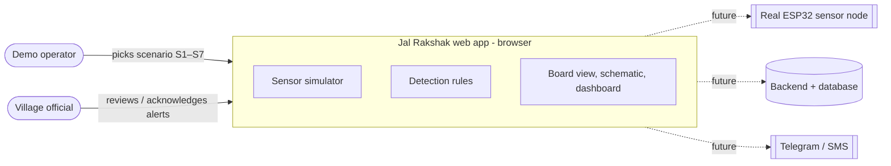
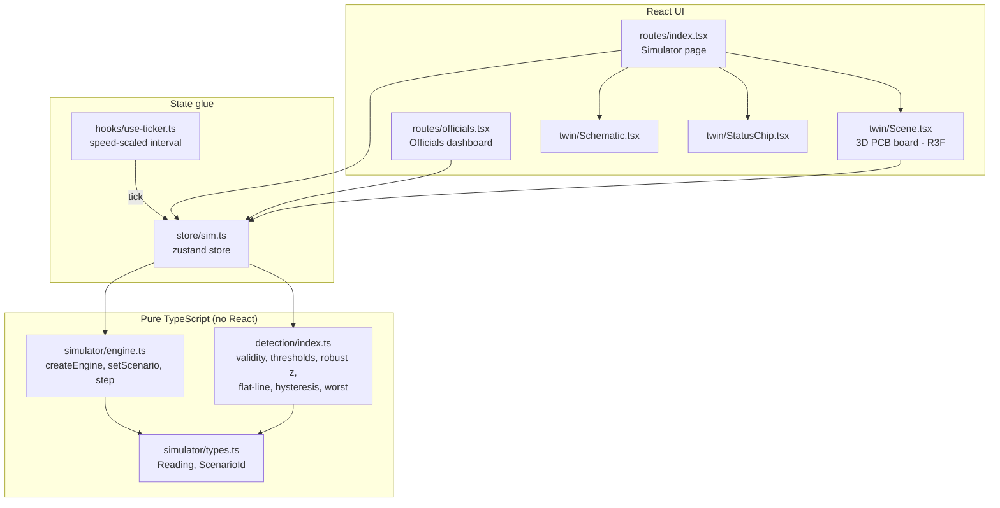
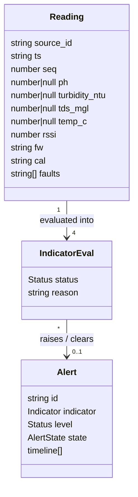
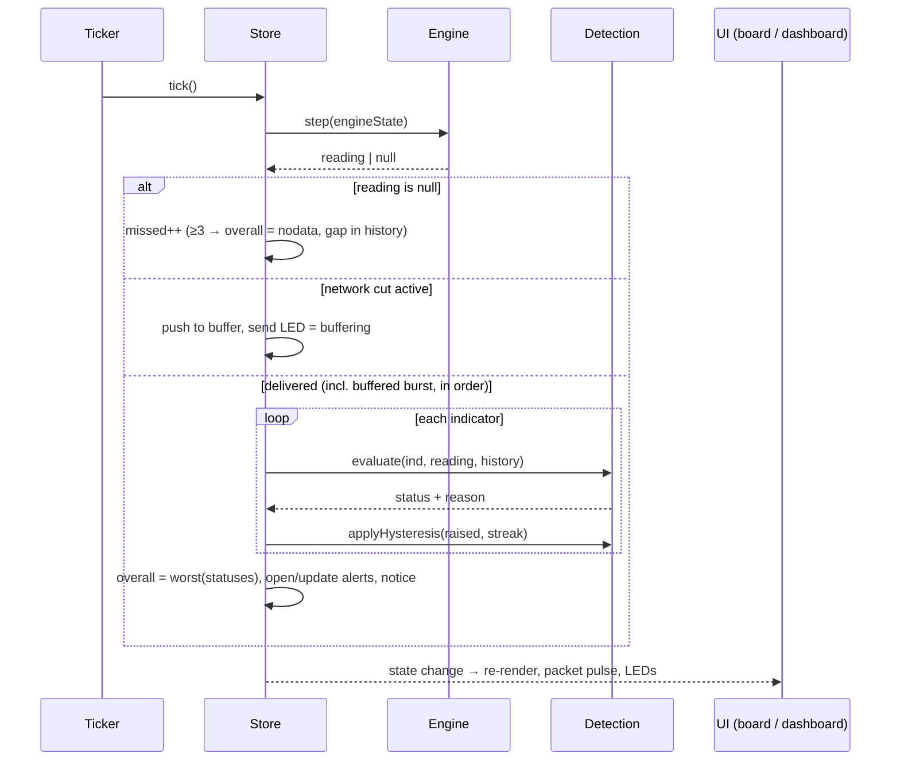
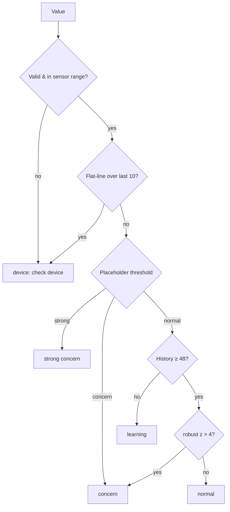
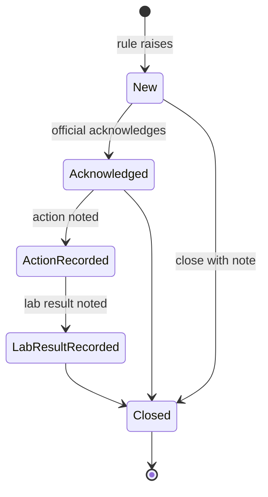
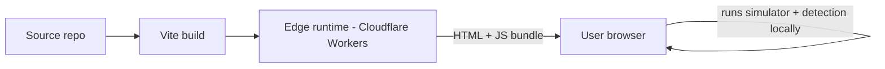
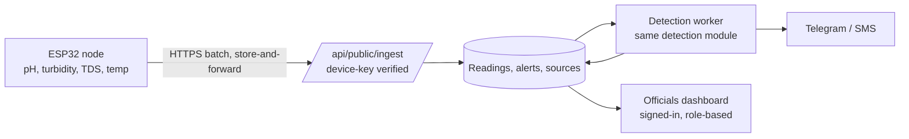

# Jal Rakshak — Technical Design Document

| | |
|---|---|
| Status | MVP (simulation only) |
| Scope | Browser app: sensor-board simulator (`/`) and officials dashboard (`/officials`) |
| Data | All readings are simulated. Warning limits are placeholders pending expert review. |

## 1. Purpose and goals

Jal Rakshak is an early-warning demo for village drinking-water sources. A simulated sensor board (pH, turbidity, TDS, temperature on an ESP32) produces readings every 5 s; detection rules classify each reading and raise alerts that officials acknowledge and close.

Goals:
- Show the full path *sensor → packet → detection → alert → official action* in one browser tab.
- Keep the simulator and detection logic pure so a real device + backend can replace the simulator without UI changes.
- Be honest: never present results as a water-safety certificate.

Non-goals (MVP): persistence, authentication, real hardware, real messaging (the Telegram-style notice is simulated), multi-source live data.

## 2. System context

## 3. Architecture overview

The app is a TanStack Start (React 19, Vite) project. Both pages render client-only (`ssr: false`) because they depend on a live in-memory simulation and WebGL.

**Rule:** `src/simulator` and `src/detection` never import React; the zustand store is the only module that joins them to the UI. Replacing the simulator with a network feed means changing only the store's `tick`.

## 4. Components

| Module | Responsibility |
|---|---|
| `simulator/types.ts` | `Reading` packet schema (`source_id, ts, seq, ph, turbidity_ntu, tds_mgl, temp_c, rssi, fw, cal, faults`), scenario list. |
| `simulator/engine.ts` | Deterministic step function, 5 s interval. Applies active scenario; S5 (unplug) returns `null`. |
| `detection/index.ts` | Per-indicator evaluation and overall status. Unit-tested in `detection.test.ts`. |
| `store/sim.ts` | Holds engine state, history (300), buffer, evals, alerts, notice, view, speed. Runs one detection pass per tick. |
| `hooks/use-ticker.ts` | Mounted once per page; calls `init()` then `tick()` every `5000 / speed` ms. |
| `twin/Scene.tsx` | Orthographic three.js scene: green PCB, sensor modules, probe cups, ESP32, LEDs, copper traces only (no wires). Reacts to status and packet events. |
| `twin/Schematic.tsx` | 2D alternative view. |
| `routes/officials.tsx` | KPIs, sources table, live readings with advice, open-alert actions. |

## 5. Data model

`Status = normal | concern | strong | device | nodata | learning`
`AlertState = New → Acknowledged → Action recorded → Lab result recorded → Closed`

## 6. Reading lifecycle (one tick)

## 7. Detection design

Evaluation order per indicator (first match wins):

- **Placeholder thresholds:** pH outside 6.5–8.5 → concern; turbidity > 1 NTU concern, > 5 strong; TDS > 500 mg/L concern, > 2000 strong. Temperature is anomaly-only.
- **Robust z-score:** `(x − median) / (1.4826 · MAD)` over a 60-reading window, with per-indicator MAD floors to avoid division blow-ups on quiet signals.
- **Hysteresis:** an alert clears only after 3 consecutive normal readings.
- **Overall status:** `worst()` priority `strong > concern > device > nodata > learning > normal`.
- **Warm start:** the store pre-generates 50 baseline readings so anomaly detection is active on first view.

## 8. Scenarios

| ID | Name | Engine effect | Expected outcome |
|---|---|---|---|
| S1 | Contaminate tank | Turbidity spike | Strong concern, notice popup |
| S2 | Drift pH | Slow pH ramp | Concern once outside range / z > 4 |
| S3 | TDS jump | Step increase in TDS | Concern or strong |
| S4 | Stick sensor | Constant value | Device (flat-line) |
| S5 | Unplug device | No packets | No data after 3 missed |
| S6 | Clean day | Quiet baseline | Normal |
| S7 | Network cut | Packets buffered on device | Buffered count, burst on reconnect |

## 9. Alert workflow

Every transition appends a timeline entry with time and note.

## 10. Rendering

- `@react-three/fiber` + `drei`, orthographic camera, auto-fit, pointer tilt, scroll zoom.
- Only flat copper traces connect parts; label leader lines are UI, not wires.
- Under 620 px the board shrinks and readings move into a list.
- Design tokens (oklch) in `src/styles.css`; Space Grotesk + JetBrains Mono loaded in `__root.tsx`; dark default with light toggle.

## 11. Deployment

All computation runs in the browser; the server only serves the app shell.

## 12. Future architecture (real deployment)

Migration path: the `Reading` schema is already the wire format; `detection/` moves server-side unchanged; the store's `tick` is replaced by a subscription to the database.

## 13. Testing

- `bunx vitest run` — detection unit tests (thresholds, z-score, flat-line, hysteresis, priority).
- Playwright screenshot checks for scenarios during development.

## 14. Risks and open questions

- Thresholds are placeholders; must be confirmed by a water-quality expert (BIS 10500 / local norms).
- Open alerts keep their first severity level; escalation rules are not yet defined.
- A sensor kit cannot detect bacteria — the UI must keep stating this is not a safety certificate.
- Multi-tab use runs separate simulations (no shared state without a backend).
